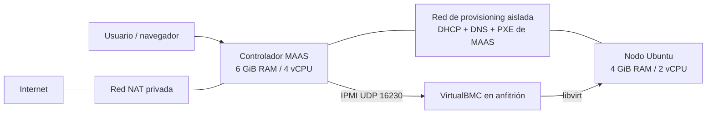

# Laboratorio MAAS desde cero

Laboratorio educativo para aprender a instalar Ubuntu en una máquina virtual desde **MAAS**, usando **QEMU/KVM**, **libvirt** y un **BMC emulado por IPMI**. Incluye preparación del anfitrión, creación del controlador, PostgreSQL, imágenes, DHCP, nodo vacío y VirtualBMC. El commissioning y el despliegue se realizan desde la interfaz web para aprender el proceso.

**No necesitas tener QEMU, KVM, libvirt ni MAAS instalados.** Necesitas un sistema Linux compatible, conexión a Internet y permisos `sudo`. Los scripts instalan los componentes que faltan. No descargues ni publiques contraseñas de otra instalación: este proyecto genera las suyas.

## Qué puedes construir



El controlador guarda el inventario, ofrece la imagen de arranque y decide cuándo instalar. El nodo empieza con un disco vacío: recibe una IP por DHCP, arranca por PXE y MAAS instala el sistema. VirtualBMC permite que MAAS gestione su encendido sin que tengas que reiniciarlo a mano.

## Compatibilidad y requisitos

| Requisito | Valor |
| --- | --- |
| Ruta principal de instalación | Ubuntu 24.04 LTS x86_64, instalado directamente en el PC |
| Ruta alternativa | Arch Linux u Omarchy actualizado; bootstrap incluido |
| CPU | Intel VT-x o AMD-V habilitado en BIOS/UEFI |
| RAM del equipo | 16 GiB mínimo recomendado; 24 GiB o más resulta más cómodo |
| CPU del equipo | 4 núcleos / 8 hilos recomendados |
| Disco | 100 GiB libres recomendados; SSD preferible |
| Internet | Necesario para paquetes, snaps e imágenes |
| Permisos | `sudo` en el anfitrión |
| Interfaz gráfica | Opcional: MAAS se usa desde navegador; virt-manager requiere escritorio |

**No funciona de forma nativa en cualquier sistema operativo.** Los scripts requieren Linux, systemd, libvirt y KVM. Windows, WSL, macOS, equipos ARM y servidores sin virtualización disponible no están cubiertos. Si tienes Windows o macOS, usa otro PC Linux compatible o instala Ubuntu en un equipo destinado al laboratorio. Ejecutarlo dentro de otra VM requiere virtualización anidada y redes adicionales; no es la ruta documentada ni verificada.

La configuración original se probó en Omarchy con Ryzen 5 5600H y 22 GiB de RAM. Esta versión automatizada incluye pruebas unitarias y comprobaciones de sintaxis, pero **todavía no fue ejecutada de principio a fin en un Ubuntu limpio ni en todas las distribuciones**. No se presenta como una certificación de portabilidad. Consulta [VALIDATION.md](docs/VALIDATION.md).

Versiones elegidas: Ubuntu invitado **24.04 LTS**, MAAS **3.7/stable**, PostgreSQL **16/stable**, VirtualBMC **3.4.0**. Los canales estables y la imagen `current` pueden recibir actualizaciones; no se garantiza una reproducción idéntica byte por byte.

## Si el PC no tiene nada preparado

1. Instala Ubuntu 24.04 LTS desde su [sitio oficial](https://releases.ubuntu.com/24.04/). Si ya tienes Arch/Omarchy, puedes conservarlo.
2. En BIOS/UEFI activa **Intel Virtualization Technology / VT-x** o **SVM / AMD-V**. Si no aparece, consulta el manual del fabricante.
3. Abre una terminal y comprueba la arquitectura:

   ```bash
   uname -m
   ```

   Debe responder `x86_64`.

4. Instala Git para poder descargar este repositorio:

   ```bash
   # Ubuntu
   sudo apt update
   sudo apt install git
   ```

   ```bash
   # Arch Linux
   sudo pacman -S --needed git
   # Omarchy: omarchy pkg add git
   ```

5. Descarga el repositorio:

   ```bash
   git clone https://github.com/SebaDRiquelmeS/maas-lab.git
   cd maas-lab
   ```

También puedes usar **Code → Download ZIP**, descomprimir y abrir una terminal dentro de la carpeta. Ningún paso del laboratorio necesita un token GitHub.

## Instalación por etapas

Ejecuta los comandos desde la carpeta del repositorio. No ejecutes todos a la vez: revisa el resultado de cada etapa. No se destruyen VM ni discos automáticamente al repetir un comando.

### 1. Preparar el anfitrión

```bash
bash scripts/bootstrap.sh
sudo python3 lab.py doctor
```

`bootstrap.sh` solicita privilegios con `sudo`, instala QEMU/KVM, libvirt, virt-manager, herramientas de red, Python, SSH e IPMI. Activa libvirt. En Arch/Omarchy usa los repositorios ya configurados; **no hace una actualización parcial con `pacman -Sy`**. Si el equipo lleva tiempo sin actualizar, realiza antes su actualización habitual y reinicia si cambió el kernel.

`doctor` comprueba arquitectura, `/dev/kvm`, herramientas y conexión a libvirt. Muestra memoria y espacio libres para que compruebes los requisitos; no reserva recursos. Si falla, no continúes: consulta [los problemas frecuentes](docs/TROUBLESHOOTING.md).

### 2. Elegir redes y recursos

```bash
cp config.example.json config.json
nano config.json
```

La configuración predeterminada crea:

| Recurso | Valor |
| --- | --- |
| Prefijo | `ml` |
| Controlador | `ml-controller`: 4 vCPU, 6144 MiB RAM, disco 50 GiB |
| Nodo | `ml-node01`: 2 vCPU, 4096 MiB RAM, disco 25 GiB |
| Red NAT | `192.168.210.0/24`, puente `vb-ml` |
| Red de despliegue | `192.168.211.0/24`, puente `vp-ml` |
| Anfitrión en red de despliegue | `192.168.211.1` |
| Controlador / DNS | `192.168.211.2` |
| DHCP de MAAS | `192.168.211.100` a `192.168.211.199` |
| Direcciones de infraestructura reservadas | `.1` a `.9` |
| BMC virtual | `192.168.211.1:16230` UDP |

Si alguna red coincide con tu LAN, VPN, Docker u otra red virtual, elige **otras dos redes /24 privadas** antes de crear el controlador. El script detecta solapamientos de rutas cuando crea redes. No permite que cambies una configuración ya utilizada con el mismo prefijo: es una protección para no administrar máquinas equivocadas.

Un laboratorio con VirtualBMC por anfitrión es la configuración soportada: el servidor de gestión local utiliza TCP 50892 (`bmc_server_port` en la configuración) y el BMC UDP 16230. Crear varios a la vez exige asignar puertos y MAC diferentes y adaptar el servicio.

### 3. Crear el controlador Ubuntu

```bash
sudo python3 lab.py controller
sudo python3 lab.py firewall
```

El primer comando descarga una imagen oficial Ubuntu 24.04, verifica su SHA-256, crea las redes privadas y un disco de 50 GiB, y arranca el controlador. `cloud-init` crea el usuario `estudiante`, su acceso SSH por clave y sus interfaces de red. La contraseña SSH está deshabilitada; el usuario tiene `sudo` sin contraseña **solo dentro de la VM de laboratorio**.

El segundo comando añade reglas limitadas si UFW está activo: DHCP y DNS para la red NAT, salida desde esa red por las interfaces con ruta predeterminada, e IPMI únicamente desde el controlador. No desactiva el cortafuegos. Si usas firewalld o reglas nftables propias, aplica las reglas equivalentes siguiendo [NETWORKING.md](docs/NETWORKING.md).

Espera entre 2 y 5 minutos para el primer arranque. Comprueba:

```bash
sudo python3 lab.py ssh
```

Este comando muestra el nombre, las interfaces y, cuando esté instalado, el estado de MAAS. Antes de instalar MAAS puede mostrar `maas: command not found`: significa que SSH ya funciona y puedes continuar. Para una sesión interactiva con los valores predeterminados:

```bash
sudo ssh -i /var/lib/maas-lab/ml/id_ed25519 \
  -o UserKnownHostsFile=/var/lib/maas-lab/ml/known_hosts \
  estudiante@192.168.211.2
```

### 4. Instalar e inicializar MAAS

```bash
sudo python3 lab.py maas
```

Puede tardar varios minutos. Espera a que termine sin cerrar la terminal. Este paso:

- Espera a que cloud-init termine.
- Desactiva `systemd-timesyncd` **dentro del controlador** para que MAAS gestione la hora con chrony.
- Instala los snaps MAAS y PostgreSQL.
- Crea el usuario y la base PostgreSQL `maas`.
- Inicializa MAAS en modo `region+rack` con dos workers.
- Crea el administrador `admin` y un perfil CLI `lab`.
- Genera contraseñas aleatorias, sin contraseñas universales compartidas.

Consulta tus credenciales de laboratorio localmente:

```bash
sudo cat /var/lib/maas-lab/ml/credentials.json
```

Abre **http://192.168.211.2:5240/MAAS/** desde el anfitrión. Usuario `admin`, contraseña del campo `admin_password`. Si cambiaste la subred, usa su dirección `.2`. La contraseña `db_password` es interna de PostgreSQL y no sirve para iniciar sesión en MAAS.

Es HTTP en una red privada de práctica; no lo expongas como servicio de producción. El estado y los secretos se guardan bajo `/var/lib/maas-lab/<prefijo>/` con permisos exclusivos de root. No deben subirse a GitHub.

### 5. Configurar DHCP e importar Ubuntu

```bash
sudo python3 lab.py configure
```

El script descubre los IDs de subred, VLAN y controlador mediante la API: no depende de los IDs de la instalación original. Configura DHCP **solo en la red aislada de provisioning**, reserva las direcciones de infraestructura, configura DNS, añade la clave pública SSH e inicia la importación Ubuntu 24.04 amd64 con kernel GA.

En MAAS abre **Images** y espera a que la imagen esté disponible / sincronizada. Según la conexión puede tardar varios minutos. Que un recurso aparezca en la lista no significa que su descarga esté completa. El paso siguiente verifica explícitamente su contenido.

La red de despliegue no tiene salida directa a tu LAN: los nodos obtienen de MAAS los recursos de arranque y usan su proxy para paquetes. Esto basta para la práctica de aprovisionamiento; el Ubuntu instalado no tendrá acceso general a Internet sin añadir posteriormente un router/NAT. Consulta [NETWORKING.md](docs/NETWORKING.md).

### 6. Crear el nodo vacío

```bash
sudo python3 lab.py node
```

El script registra `ml-node01` en MAAS y crea su VM vacía con 2 vCPU, 4 GiB RAM, disco de 25 GiB y una interfaz en la red de provisioning. Arranca primero por red y después por disco. Si la imagen está incompleta, se detiene y explica que debes esperar.

Deja que el primer arranque temporal termine y el nodo se apague. En MAAS aparecerá como **New**. **Este arranque no instala Ubuntu en el disco.**

### 7. Emular el BMC

```bash
sudo python3 lab.py bmc
```

Instala VirtualBMC en un entorno Python separado, crea un servicio systemd del anfitrión y lo habilita para próximos arranques. El servicio utiliza libvirt y necesita permisos administrativos; sus archivos y credenciales se guardan en el directorio privado de root. Escucha IPMI en la IP privada `.1`, puerto UDP 16230, y conecta MAAS mediante IPMI 2.0, cipher 3 y arranque legacy.

Al final debe aparecer una respuesta como `{'state': 'off'}` o `{'state': 'on'}`. La consulta no apaga ni reinicia la VM. A partir de aquí MAAS puede gestionar su energía automáticamente. El servicio espera a libvirt y reintenta si la red virtual aún no está disponible; los puentes se crean con redes libvirt de inicio automático.

El BMC controla **la VM del nodo**, no el PC físico ni el controlador MAAS. Si apagas el anfitrión no hay BMC disponible.

### 8. Hacer commissioning desde MAAS

1. Abre **Machines → ml-node01**.
2. En sus opciones de energía comprueba que aparece **IPMI**, no Manual.
3. Selecciona la acción **Commission**. Los nombres pueden variar ligeramente entre versiones de la interfaz.
4. Espera mientras arranca y MAAS identifica discos, red, CPU y memoria.
5. Comprueba que termina en **Ready** y que Commissioning muestra **Passed**.

Commissioning es la inspección de la máquina antes de asignarla a una instalación. No equivale a tener Ubuntu instalado en el disco. Puede tardar varios minutos y las pruebas de hardware añaden tiempo.

### 9. Desplegar Ubuntu tú mismo

1. Selecciona el nodo en estado **Ready**.
2. Elige **Deploy**.
3. Selecciona **Ubuntu 24.04 LTS / Noble** y confirma.
4. Observa **Deploying** y sus eventos.
5. Espera hasta **Deployed**.

El script nunca ejecuta `deploy` ni libera o borra una máquina. El usuario elige cuándo instalar desde MAAS. Con IPMI configurado, el ciclo de encendido lo gestiona MAAS; no necesitas el reinicio manual usado en la primera versión del laboratorio.

Como orientación, un despliegue puede tardar **3-10 minutos**; las descargas, las pruebas y la carga pueden alargarlo. El primer montaje completo suele requerir bastante más: reserva al menos **30-60 minutos**. Un vídeo de un minuto puede mostrar el resultado o resumirlo, pero no garantiza una instalación real en ese tiempo.

### 10. Ver y comprobar el resultado

```bash
sudo python3 lab.py status
virt-manager --connect qemu:///system --show-domain-console ml-node01
```

En un servidor sin escritorio, instala virt-manager en un equipo cliente o usa la consola serie si el invitado la tiene configurada:

```bash
sudo virsh -c qemu:///system console ml-node01
# Salir: Ctrl + ]
```

La consola gráfica funciona aunque no exista salida serie. En MAAS consulta la IP asignada; **no la adivines**, ya que puede ser diferente de la usada durante DHCP. Desde el anfitrión:

```bash
sudo ssh -i /var/lib/maas-lab/ml/id_ed25519 \
  -o UserKnownHostsFile=/var/lib/maas-lab/ml/known_hosts \
  ubuntu@IP_QUE_MUESTRA_MAAS
```

El usuario del Ubuntu desplegado normalmente es `ubuntu`, mientras que el controlador usa `estudiante`. No hay una contraseña de consola predefinida: entra mediante la clave SSH que MAAS instala.

Verificación dentro del nodo:

```bash
hostname
cat /etc/os-release
lsblk
ip -brief address
```

Para probar el BMC desde MAAS, usa las acciones de energía del nodo cuando no tenga trabajo pendiente. El apagado forzado corta la alimentación virtual; guarda antes tus cambios.

## Estado, repetición y recuperación

Los pasos existentes se reutilizan cuando es seguro: el controlador y nodo no se recrean si ya existen y las redes existentes se comprueban. Esto **no es una transacción ni un recuperador universal**: si cortas una instalación a mitad, revisa el error y el estado antes de repetir. No borres las credenciales para arreglar un error: podrían ser necesarias para la base ya creada.

Puedes indicar otra configuración con `sudo python3 lab.py --config /ruta/config.json status`. Mantén el mismo archivo en todas las etapas. Si pierdes `config.json`, existe una copia del utilizado en `/var/lib/maas-lab/<prefijo>/config.json`.

Consulta [TROUBLESHOOTING.md](docs/TROUBLESHOOTING.md), [NETWORKING.md](docs/NETWORKING.md) y [VALIDATION.md](docs/VALIDATION.md). Para eliminar el laboratorio de forma deliberada, sigue [CLEANUP.md](docs/CLEANUP.md).

## Estructura

```text
lab.py                       Orquestador por etapas, requiere sudo
config.example.json          Redes, nombres y recursos de ejemplo
scripts/bootstrap.sh         Dependencias del anfitrión
scripts/guest-init.py        Base de datos, MAAS y administrador
scripts/guest-configure.py   DHCP, DNS, clave e imágenes
tests/                      Pruebas sin crear VM
docs/                       Red, diagnóstico, eliminación y validación
.github/workflows/checks.yml Validación automática
```

Los discos están en `/var/lib/libvirt/images/maas-lab-<prefijo>/`, no en el repositorio. No se incluyen la imagen Ubuntu, claves privadas, contraseñas, la configuración original del equipo ni máquinas exportadas.

## Desarrollo y contribuciones

```bash
python3 -m unittest discover -s tests -v
python3 -m compileall -q lab.py scripts tests
bash -n scripts/bootstrap.sh
```

Las pruebas usan simulaciones y no requieren root, KVM ni Internet. Para validar cambios en aprovisionamiento necesitas una máquina de pruebas y completar las etapas reales. Reporta distribución, versiones, etapa que falla y registros sin secretos.

## Fuentes y licencia

- [Ubuntu 24.04 LTS](https://releases.ubuntu.com/24.04/)
- [Versiones y dependencias de MAAS](https://canonical.com/maas/docs/release-information/supported-maas-versions/)
- [Instalación oficial de MAAS](https://canonical.com/maas/docs/latest/how-to-guides/get-started/install-maas/)
- [Configuración oficial de MAAS](https://canonical.com/maas/docs/latest/how-to-guides/get-started/configure-maas/)
- [VirtualBMC de OpenStack](https://docs.openstack.org/virtualbmc/latest/user/index.html)
- [libvirt y cortafuegos](https://libvirt.org/firewall.html)

Licencia MIT para el código y documentación originales de este repositorio. Ubuntu, MAAS, VirtualBMC y el resto de componentes conservan sus respectivas licencias. Foreman no forma parte de este proyecto.
